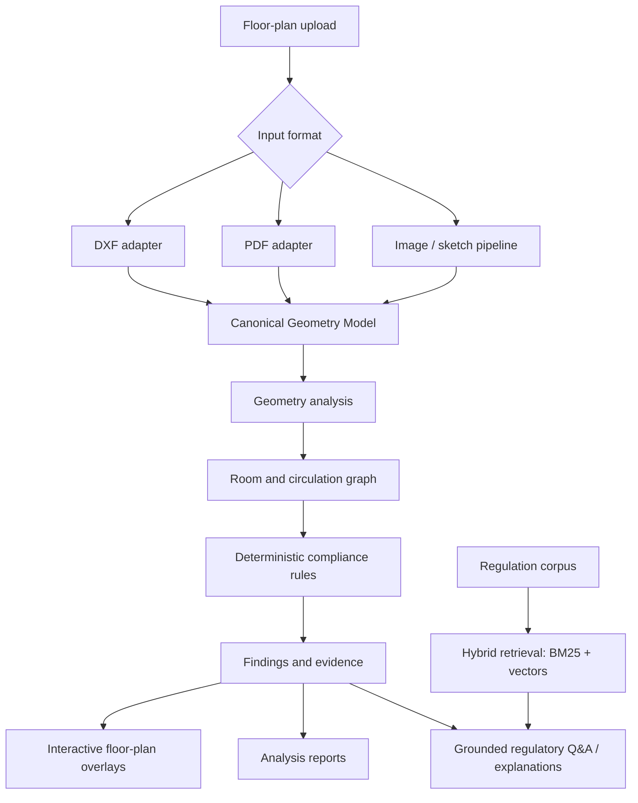

# BuildWise AI

> **Intelligent Architectural Analysis and Regulatory Compliance Screening**

BuildWise AI is an architectural drawing analysis platform built with **FastAPI, React, TypeScript, PostgreSQL, and Python-based geometry and compliance engines**. It is designed to transform floor-plan drawings into a normalized spatial model, analyze circulation and selected building-code requirements, visualize findings on an interactive floor plan, and provide regulation-grounded explanations.

> [!IMPORTANT]
> **Project status: Discontinued v1 prototype.** This repository is retained as a reference implementation and portfolio project, not a production-ready building approval system.
>
> BuildWise AI provides early-stage screening only. It is not a statutory authority, does not issue compliance certificates or guarantee permit approval, and does not replace review by a licensed architect, fire-safety professional, or relevant local authority. Regulatory thresholds and clause references must be verified against authoritative code documents and applicable local bye-laws before being relied upon.

>For current better implementation check v2 on my profile with improved architechture and additional features. 

---

## Overview

Architectural plans contain geometry, room relationships, openings, circulation paths, and dimensions. Manually checking these details against building regulations can be tedious. BuildWise AI explores an explainable workflow combining geometry processing, graph algorithms, deterministic rules, and retrieval-augmented generation (RAG) to make early plan reviews easier to inspect.

### What it does

- Ingests supported architectural drawings, including DXF, vector PDF, and raster images where supported by the implementation.
- Converts extracted information into a format-independent **Canonical Geometry Model (CGM)**.
- Derives room geometry, areas, dimensions, and room connectivity.
- Builds a topological room/circulation graph for reachability and egress analysis.
- Runs deterministic checks against the configured compliance-rule registry.
- Links findings to drawing entities for visual inspection.
- Produces structured analysis results and reports.
- Answers regulatory questions using retrieved NBC source passages and citations.

### What it is not

- A structural engineering or load-calculation tool.
- A BIM authoring or generative-design platform.
- A substitute for site inspections or professional sign-off.
- A guarantee that a plan will be approved by a municipal authority.

## Core Workflow



## Key Capabilities

### 1. Drawing ingestion and geometry extraction

Format-specific adapters keep file parsing separate from analysis logic.

- **DXF:** Entity and layer parsing using `ezdxf`.
- **PDF:** Text and vector extraction using `pdfplumber`, followed by heuristic interpretation of geometric paths.
- **Raster images:** Classical computer-vision components using OpenCV for image cleanup, line detection, contour extraction, and geometry inference where supported by the current pipeline.
- **Canonical model:** A shared spatial representation lets downstream engines work independently of the original input format.

Drawing formats vary significantly. CAD layer conventions may be inconsistent, while PDFs and images may not contain explicit semantic labels. Extracted geometry can therefore be incomplete or uncertain and should be reviewed.

### 2. Geometry and circulation analysis

- **Shapely and NumPy** for geometry operations and measurements.
- **NetworkX** for room connectivity and graph traversal.
- Room-boundary and area extraction.
- Topological graph construction from detected spaces and connections.
- Circulation, exit reachability, travel-distance, and dead-end analysis where the input supports reliable measurements.
- Evidence and entity references to associate findings with the drawing viewer.

### 3. Deterministic compliance engine

Compliance checks are implemented as Python rules and return structured results. The LLM is not the authority for numerical pass/fail decisions.

Rule modules in the repository cover categories such as corridor width, door width, stair width, room area, dead-end circulation, exit count, travel distance, and ventilation ratio. The rule registry and implementations determine which checks are enabled and the thresholds they use.

A finding is designed to include:

- Rule ID, title, and status.
- Severity and explanation.
- Measured and configured required values, including units.
- Evidence used by the check.
- Regulation source metadata where available.
- Recommendation and confidence information.
- Geometry references for visualization.

**The existence of a rule in code does not certify its interpretation or threshold.** Confirm the authoritative source, scope, occupancy type, exceptions, local amendments, and units before using any rule for a real project. When dimensions or geometry cannot be established, uncertainty should be communicated rather than implying a definitive pass.

### 4. Interactive analysis workspace

The React interface includes project and analysis workflows, a floor-plan viewer, inspection details, a compliance matrix, report views, regulatory chat, and a topological graph visualization.

The review experience is designed to let users select a finding and inspect its related drawing geometry, measurements, evidence, and recommendations. The backend exposes analysis and job-status routes, including WebSocket support for progress updates.

### 5. Regulatory RAG and explanations

The regulatory question-answering pipeline combines sparse keyword retrieval and dense semantic search over ingested regulatory text. Relevant excerpts and metadata are returned as citations. The configured Gemini provider pool can generate natural-language answers grounded in those excerpts; a direct cited-text fallback is available when model generation is not available.

The intended authority boundary is explicit:

- Retrieval supplies source passages and metadata.
- Deterministic Python rules evaluate configured numerical checks.
- The LLM explains retrieved regulatory material and completed findings.
- The LLM must not invent regulatory values or override rule results.
- If retrieval is insufficient, the answer should communicate that limitation.

Regulation documents may be subject to copyright or redistribution restrictions. Only ingest or redistribute documents where use is permitted.

## Architecture

```text
BuildWise AI
├── frontend/                    React 18 + TypeScript + Vite
│   ├── pages/                   Landing, projects, workspace, progress
│   ├── components/              Plan viewer, inspection, graph, reports, RAG chat
│   ├── api/                     Backend client
│   └── types/                   Frontend data contracts
│
├── backend/
│   ├── app/
│   │   ├── api/                 FastAPI routes
│   │   ├── models/              SQLAlchemy models
│   │   ├── schemas/             Pydantic schemas
│   │   ├── jobs/                Analysis job orchestration
│   │   └── services/            Application services
│   ├── engines/
│   │   ├── ingestion/           DXF, PDF, and image adapters
│   │   ├── geometry/            Canonical model and spatial extraction
│   │   ├── graph/               Room connectivity and graph building
│   │   ├── compliance/          Rule registry and deterministic checks
│   │   ├── rag/                 Regulation retrieval and citation logic
│   │   ├── llm/                 Gemini provider integration
│   │   └── reporting/           Report serialization and rendering
│   ├── alembic/                 Database migrations
│   └── tests/                   Unit and integration tests
│
├── docker-compose.yml
├── docker-compose.dev.yml
├── .env.example
├── Makefile
├── buildwise_architecture_v1.md
└── buildwise_spec_v2.md
```

### Request lifecycle

1. The frontend uploads a drawing through the FastAPI API.
2. The backend validates and stores the file, then creates an analysis job.
3. An ingestion adapter converts the drawing to the canonical floor-plan model.
4. Geometry and graph engines derive room metrics and connectivity.
5. The compliance engine evaluates enabled deterministic rules.
6. Analysis results and the floor-plan snapshot are persisted.
7. The frontend retrieves results and renders findings on the plan.
8. The RAG service retrieves regulation excerpts and generates cited answers where configured.

## Technology Stack

| Layer | Technologies |
|---|---|
| Frontend | React 18, TypeScript, Vite, React Router, TanStack Query, Axios, Tailwind CSS |
| Visualization | SVG-based floor-plan viewer, graph visualization, compliance matrix, Recharts where used |
| Backend API | Python, FastAPI, Pydantic, Uvicorn |
| Database and migrations | PostgreSQL 15, SQLAlchemy 2.x, asyncpg, Alembic |
| Vector search | pgvector |
| CAD and PDF | ezdxf, pdfplumber |
| Computer vision and geometry | OpenCV, NumPy, Shapely, SciPy |
| Graph algorithms | NetworkX |
| Retrieval | BM25 + dense vector retrieval, `BAAI/bge-large-en-v1.5` embedding configuration |
| LLM | Configured Gemini model pool with fallback behavior |
| Containers | Docker, Docker Compose |
| Tests and code quality | pytest, Ruff, mypy, frontend ESLint |

See the checked-in dependency and configuration files for precise libraries and options used by this version.

## Canonical Geometry Model

The **Canonical Geometry Model (CGM)** is the common contract between ingestion and analysis. It represents floors and entities such as walls, rooms, openings, stairs, and exits independently of the input file format.

The model carries geometry, derived measurements, floor associations, confidence, source metadata, and entity relationships where available. Analysis snapshots can be stored as structured JSON in PostgreSQL, while compliance results link back to source entities for visual highlighting.

This separation allows the same downstream geometry and compliance code to process data from different ingestion adapters without coupling the rule engine to DXF, PDF, or image internals.

## API Surface

The backend uses versioned REST routes and a WebSocket endpoint for processing updates. Confirm exact routes and schemas against the running API.

| Area | Example routes |
|---|---|
| Health | `GET /health` |
| Projects | `/api/v1/projects` |
| Document upload and retrieval | `/api/v1/documents` and project document routes |
| Analysis | `/api/v1/analysis` |
| Compliance results | `/api/v1/compliance` and analysis compliance routes |
| Regulatory Q&A | `POST /api/v1/chat/query` |
| Reports | `/api/v1/reports` |
| Job progress | WebSocket analysis status routes |

When debug mode is enabled, FastAPI documentation is normally available at `http://localhost:8000/docs`.

## Getting Started

### Prerequisites

- Git
- Docker and Docker Compose
- Node.js compatible with the frontend lockfile
- Python compatible with the backend dependencies
- A Gemini API key for model-generated explanations and regulatory answers (optional for non-LLM paths)

### 1. Clone the repository

```bash
git clone https://github.com/inddivyansh/BuildWiseAI_v1_Discontinued.git
cd BuildWiseAI_v1_Discontinued
```

### 2. Configure environment

Copy the example configuration and update credentials:

```bash
cp .env.example .env
```

On Windows PowerShell:

```powershell
Copy-Item .env.example .env
```

Set a secure PostgreSQL password and JWT secret. Add a valid `GEMINI_API_KEY` if you want Gemini-backed explanations. Never commit `.env`, API keys, uploaded drawings, or restricted regulatory PDFs.

### 3. Run the full stack

```bash
make up
```

The Makefile is configured to build and start the Docker Compose stack. The default endpoints documented by the project are:

- Frontend: http://localhost
- Backend API: http://localhost:8000
- API documentation in debug/development mode: http://localhost:8000/docs

Stop the containers with:

```bash
make down
```

### Development workflow

Start the development backend and database:

```bash
make dev
```

Then run the frontend in a separate terminal:

```bash
cd frontend
npm install
npm run dev
```

Use the Makefile to view additional helper commands:

```bash
make help
```

The backend development container provides the configured Python environment. If running the backend outside Docker, create a virtual environment and install the dependencies listed in the backend project files.

### Regulation ingestion

The repository includes a Makefile target for ingesting regulation PDFs into the retrieval corpus:

```bash
make ingest-regulations
```

Place source documents only in the expected local data directory and verify that you have permission to use them. Ingestion depends on the current configuration and available files.

## Testing and Code Quality

The repository provides Makefile targets intended to run tests and quality checks:

```bash
make test
make test-unit
make test-integration
make lint
make format
```

Test extraction, geometry, graph connectivity, compliance decisions, API behavior, report schemas, and retrieval/citation behavior. Regulatory-rule tests should include pass, fail, and boundary cases, with expected results reviewed against the source requirements.

This README makes no benchmark or compliance-accuracy claim. Such claims should be supported by repeatable evaluation fixtures and domain review.

## Regulatory Safety and Limitations

- **Not a statutory certificate:** Results are preliminary screening aids, not approval decisions.
- **Rule verification is essential:** NBC clauses, thresholds, occupancy conditions, exceptions, and local bye-laws must be checked against authoritative material.
- **Input quality affects outcomes:** Ambiguous lines, missing dimensions, unknown drawing scales, and inconsistent layers can affect measurements.
- **Some checks are heuristic:** Image/PDF-derived geometry and environmental ratio checks may be approximate.
- **Professional review remains necessary:** Final interpretation belongs to qualified professionals and relevant authorities.
- **Not production-hardened:** This discontinued prototype should not be used as the sole basis for construction, life-safety, permitting, or purchasing decisions.
- **Future scope is not current support:** Planned capabilities in architecture documents are not necessarily implemented or production-ready in this version.

## Future Directions

The wider product specification explored several possible extensions:

- More robust multi-floor circulation and egress analysis.
- Better uncertainty review for raster and vector extraction.
- Additional source-verified compliance rules and jurisdiction-specific configuration.
- Durable distributed processing for higher concurrency.
- More advanced RAG reranking and regulatory corpus management.
- IFC ingestion, accessibility checks, and specialized building-performance integrations.

These are roadmap ideas, not a commitment that they are implemented in this discontinued version.

## Contributing

This repository is retained for reference. For experimental changes:

1. Add tests for new ingestion or geometry behavior.
2. Keep compliance pass/fail decisions deterministic and separately testable.
3. Include the source, version, clause, scope, and units for any regulatory rule.
4. Make low-confidence extraction and missing evidence visible to users.
5. Do not commit credentials, personal drawings, or documents without redistribution rights.

## License

Check the repository for a `LICENSE` file before reusing or redistributing the code. If no license is present, do not assume public availability grants permission to reuse the project.
